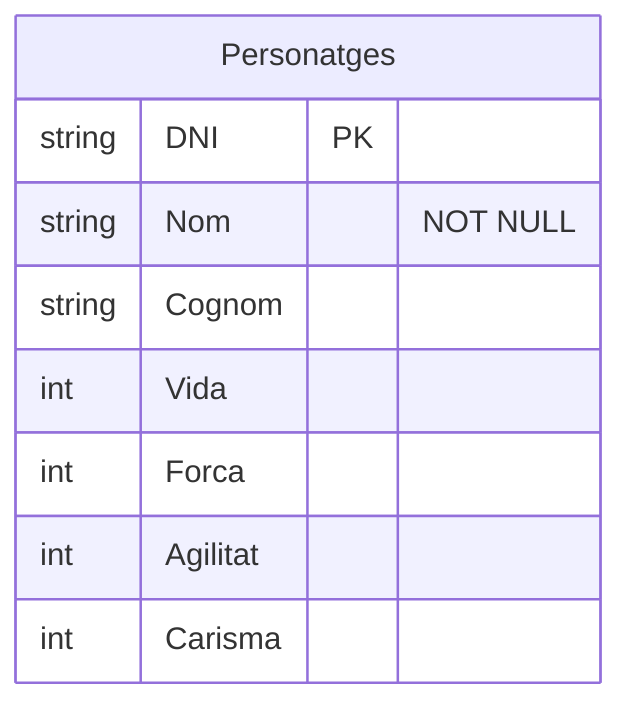
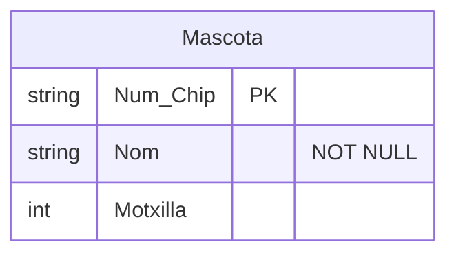
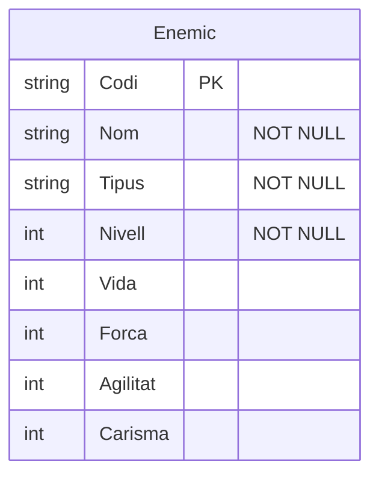
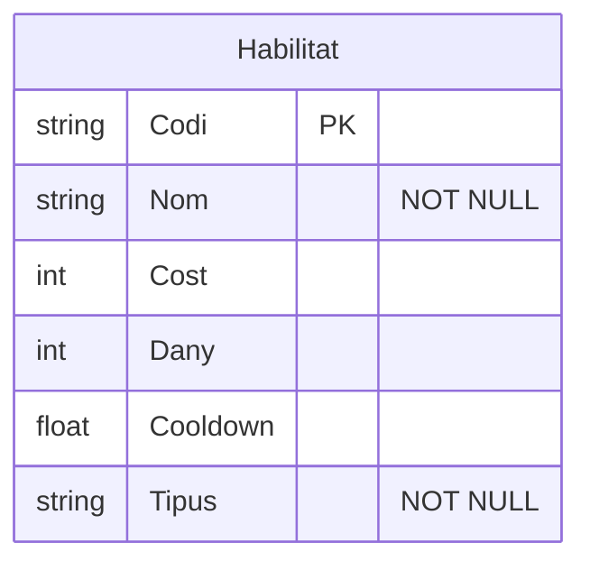
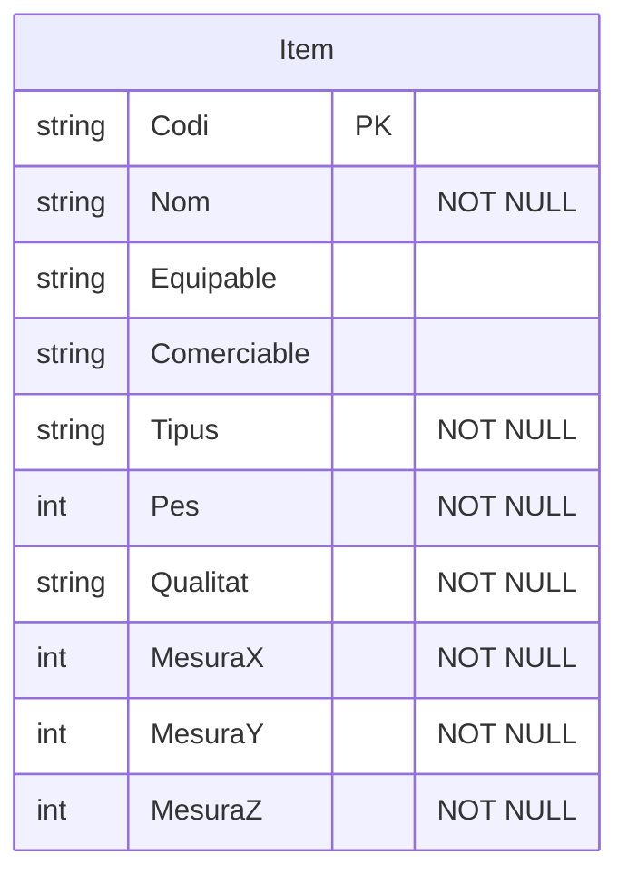

## Entitat de Personatges

## Explicació

Primer he creat l'entitat Personatges, que representa els personatges del videojoc. He afegit el DNI com a clau primària i els atributs corresponents.


# AEntitat Mascota

He creat l'entitat Mascota per representar les mascotes del videojoc. He afegit el número de xip com a clau primària (PK), el nom i la motxilla.



# Entitat Enemic

He creat l'entitat Enemic per representar els enemics del videojoc. Cada enemic té un codi com a clau primària (PK), un nom, un tipus, un nivell i diferents estadístiques.



# Entitat Habilitat


He creat l'entitat Habilitat per representar les habilitats del videojoc. He afegit un codi com a clau primària (PK), el nom, el cost, el dany, el temps de reutilització i el tipus.



#  Entitat Item

He creat l'entitat Item per representar els objectes del videojoc. He afegit un codi com a clau primària (PK), el nom, si es pot equipar o comerciar, el tipus, el pes, la qualitat i les dimensions.




## Diagrama entero

```mermaid
erDiagram
    Personatges{
        string DNI PK
        string Nom "NOT NULL"
        string Cognom
        int Vida
        int Força
        int Agilitat
        int Carisma
    }

    Mascota{
        string Num.Chip PK
        string Nom "NOT NULL"
        int Motxilla
    }

    Enemic{
        string Codi PK
        string Nom "NOT NULL"
        string Tipus "NOT NULL"
        int Nivell "NOT NULL"
        int Vida 
        int Força 
        int Agilitat
        int Carisma  
    }

    Habilitat{
        string Codi PK
        string Nom "NOT NULL"
        int Cost
        int Dany
        float Cooldown
        string Tipus "NOT NULL"
    }

    Item{
        string Codi PK
        string Nom "NOT NULL"
        string Equipable
        string Comerciable
        string Tipus "NOT NULL"
        int Pes "NOT NULL"
        string Qualitat "NOT NULL"
        int MesuraX "NOT NULL"
        int MesuraY "NOT NULL"
        int MesuraZ "NOT NULL"
        
    }
    Personatges || -- || Mascota : Acompanya
    Personatges }o -- o{ Enemic : Enfrenta
    Personatges }o -- o{ Habilitat : Poseeix
    Personatges }o -- o{ Item : Equipa
    Habilitat }o -- o{ Enemic : Enfrenta
    Habilitat }o -- o{ Habilitat : Combina_amb
    Mascota }o -- o{ Item : Carrega
```
