## Entitat de Personatges

Primer he creat l'entitat Personatges, que representa els personatges del videojoc. He afegit el DNI com a clau primària i els atributs corresponents.

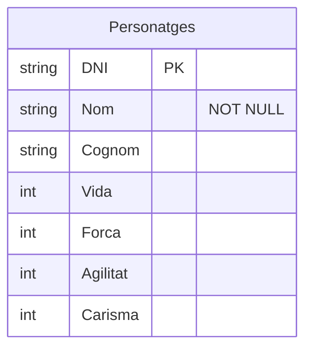
# Entitat Mascota

He creat l'entitat Mascota per representar les mascotes del videojoc. He afegit el número de xip com a clau primària (PK), el nom i la motxilla.

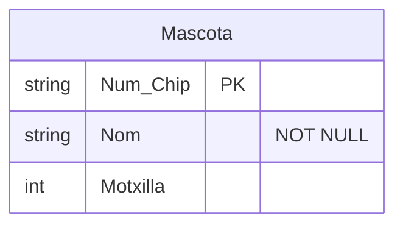

# Entitat Enemic

He creat l'entitat Enemic per representar els enemics del videojoc. Cada enemic té un codi com a clau primària (PK), un nom, un tipus, un nivell i diferents estadístiques.

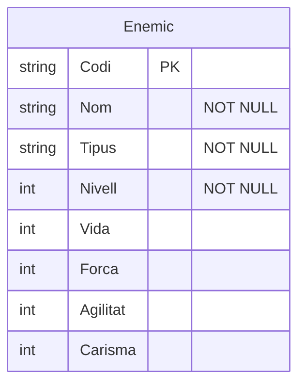

# Entitat Habilitat


He creat l'entitat Habilitat per representar les habilitats del videojoc. He afegit un codi com a clau primària (PK), el nom, el cost, el dany, el temps de reutilització i el tipus.

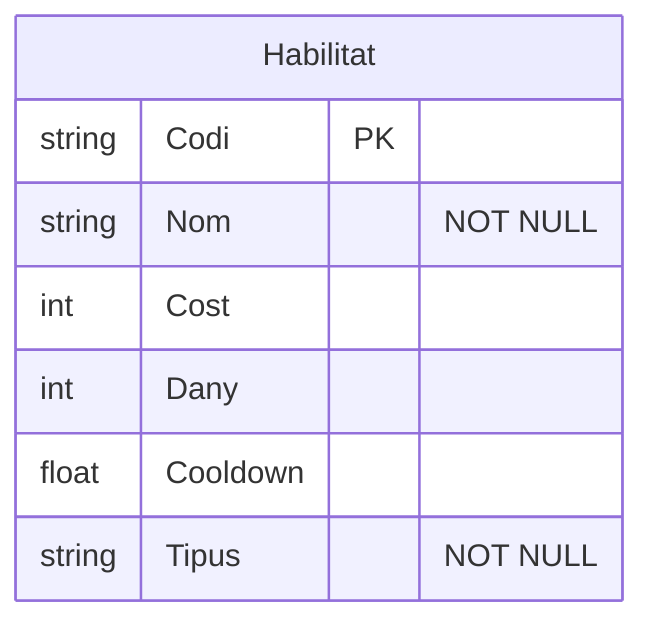

#  Entitat Item

He creat l'entitat Item per representar els objectes del videojoc. He afegit un codi com a clau primària (PK), el nom, si es pot equipar o comerciar, el tipus, el pes, la qualitat i les dimensions.

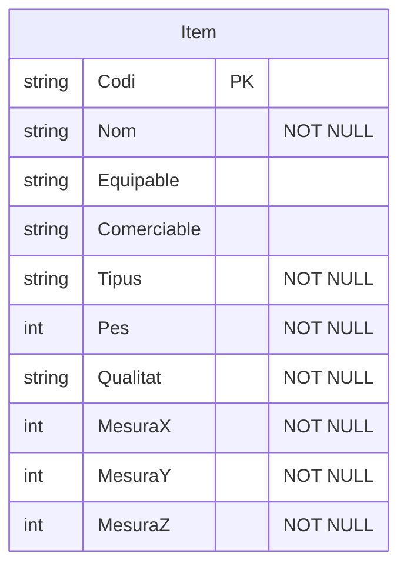

##  Relació entre Personatges i Mascota

He creat la relació Acompanya entre Personatges i Mascota.
És una relació d'un a un (1:1), que indica que cada personatge
té una mascota i cada mascota acompanya un personatge.

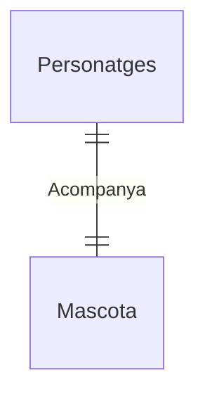

## Relació entre Personatges i Enemic

He creat la relació Enfrenta entre Personatges i Enemic.
És una relació de molts a molts (N:M), ja que un personatge
pot enfrontar-se a diversos enemics i un enemic pot
enfrontar-se a diferents personatges.

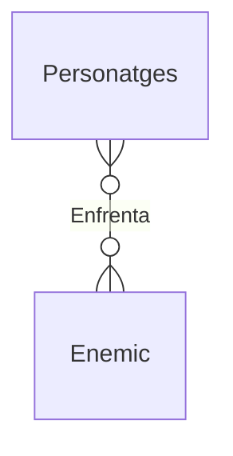

## Relació entre Personatges i Habilitat

He creat la relació Poseeix entre Personatges i Habilitat.
És una relació de molts a molts (N:M), perquè un personatge
pot tenir diverses habilitats i una mateixa habilitat
pot pertànyer a diferents personatges.

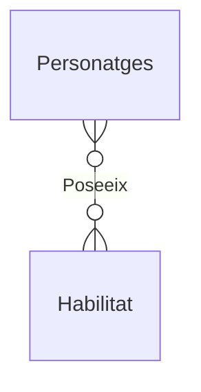

## Relació entre Personatges i Item

He creat la relació Equipa entre Personatges i Item.
És una relació de molts a molts (N:M), ja que un personatge
pot equipar diferents objectes i un mateix tipus d'objecte
pot ser equipat per diversos personatges.

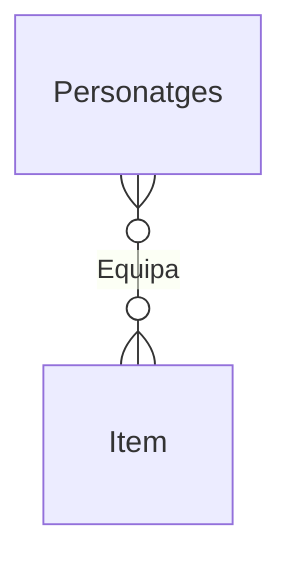

## Relació entre Habilitat i Enemic

He creat la relació Enfrenta entre Habilitat i Enemic.
És una relació de molts a molts (N:M), perquè una habilitat
pot utilitzar-se contra diversos enemics i un enemic
pot rebre diferents habilitats.

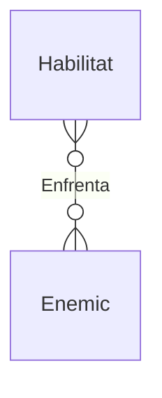

## Relació entre Habilitat i Habilitat

He creat la relació Combina_amb entre Habilitat i Habilitat.
És una relació de molts a molts (N:M), ja que una habilitat
es pot combinar amb diverses habilitats per crear
diferents combinacions.

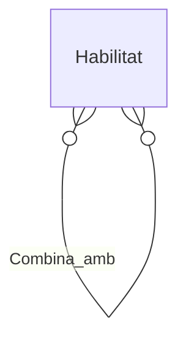

## Relació entre Mascota i Item

He creat la relació Carrega entre Mascota i Item.
És una relació de molts a molts (N:M), perquè una mascota
pot portar diversos objectes a la motxilla i un mateix
tipus d'objecte pot ser transportat per diferents mascotes.

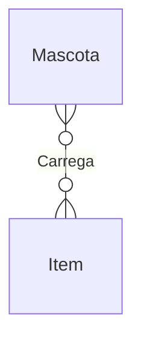

# Diagrama de les relacions


Finalment, he ajuntat totes les relacions en un únic diagrama
per veure com es connecten les diferents entitats del videojoc.

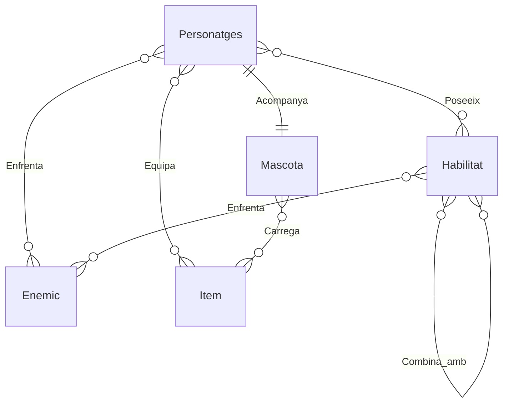

## Diagrama entero

```mermaid
erDiagram
    Personatges{
        string DNI PK
        string Nom "NOT NULL"
        string Cognom
        int Vida
        int Força
        int Agilitat
        int Carisma
    }

    Mascota{
        string Num.Chip PK
        string Nom "NOT NULL"
        int Motxilla
    }

    Enemic{
        string Codi PK
        string Nom "NOT NULL"
        string Tipus "NOT NULL"
        int Nivell "NOT NULL"
        int Vida 
        int Força 
        int Agilitat
        int Carisma  
    }

    Habilitat{
        string Codi PK
        string Nom "NOT NULL"
        int Cost
        int Dany
        float Cooldown
        string Tipus "NOT NULL"
    }

    Item{
        string Codi PK
        string Nom "NOT NULL"
        string Equipable
        string Comerciable
        string Tipus "NOT NULL"
        int Pes "NOT NULL"
        string Qualitat "NOT NULL"
        int MesuraX "NOT NULL"
        int MesuraY "NOT NULL"
        int MesuraZ "NOT NULL"
        
    }
    Personatges || -- || Mascota : Acompanya
    Personatges }o -- o{ Enemic : Enfrenta
    Personatges }o -- o{ Habilitat : Poseeix
    Personatges }o -- o{ Item : Equipa
    Habilitat }o -- o{ Enemic : Enfrenta
    Habilitat }o -- o{ Habilitat : Combina_amb
    Mascota }o -- o{ Item : Carrega
```
